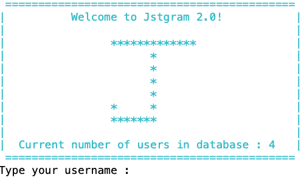
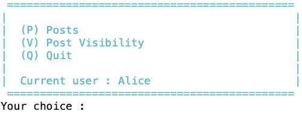
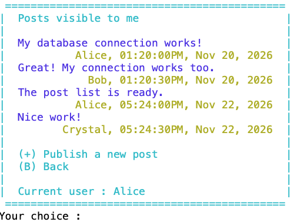
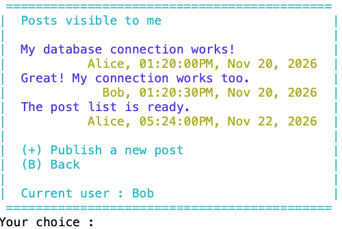
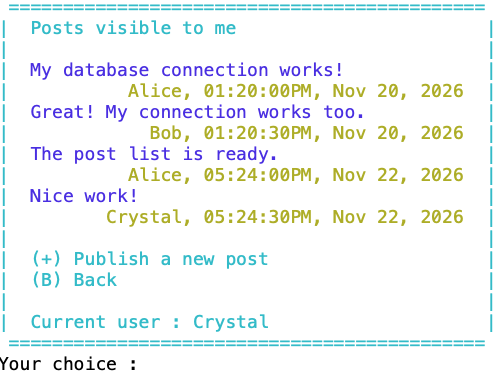
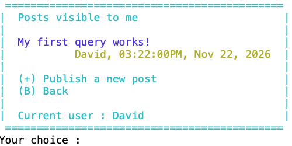
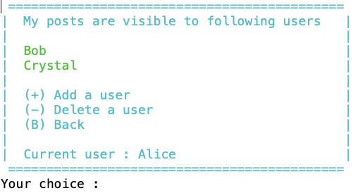
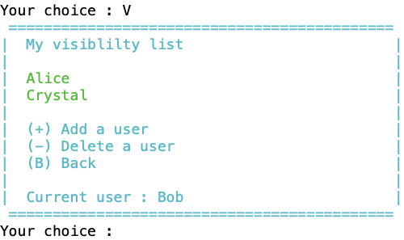
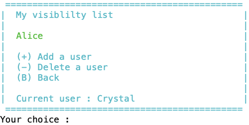
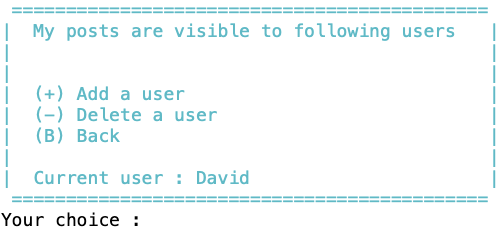

# Computer Science II

## Project 2 Database

This project is part of Computer Science II (CSCE 156) for Fall 2026 in the [School of Computing](https://computing.unl.edu) at the [University of Nebraska–Lincoln](https://www.unl.edu).

## Overview

### Project Objectives

After completing this project, you should be able to:

* Establish a JDBC connection to a database server.

* Use JDBC to query and process a result set from a database server.

* Use JDBC to insert new data into or delete existing data from a database.

* Design database tables in 3NF (Third Normal Form).

### Working with a Partner

You may work by yourself or with one other student. See Sections 5 and 6 for submission and individual grading instructions.

## 1. Relation to Project 1

This project is independent of Project 1, although both projects develop Jstgram. You do not need to reuse your code from Project 1. In fact, it is recommended not to use your Project 1 code because of the significant differences between these two projects.

Use the starter project provided in this repository.

1. Clone `https://github.com/lisongxu/CSCE156-Project-DB` in Eclipse. The Eclipse project is named `Project2`.

2. In `Database.java`, replace `your_mysql_username` and `your_mysql_password` with your MySQL username and password.

3. Run `Main.java` as a Java application. It should print `Connected to the database.` and display the basic *Main Window* layout.

The starter follows the structure of the JDBC project studied in class:

```text
Project2/
    src/
        unl/
            soc/
                Main.java
                Database.java
                View.java
    lib/
        mysql-connector-j-9.7.0.jar
    dbinit.sql
    design.docx
    .project
    .classpath
```

`Database.java` provides the connection code, and the JDBC driver is already included in the build path. `Main.java` currently checks the connection and calls `View.mainWindow()`. `View.java` provides basic layouts and menus for the four windows. You will complete the application, design the database in `dbinit.sql`, and write a design document using the outline in `design.docx`.

## 2. Social Media Application - Jstgram

In this project, we will design and develop a database version of *Jstgram*.

### 2.1 Database

All information should be stored on the database server `nuros.unl.edu`. Please complete the MySQL initialization script `dbinit.sql` to set up the database before Jstgram starts. The MySQL initialization script creates the tables and inserts the predefined user and post data as specified below.

### 2.2 Users

To simplify the project, your application does not need to support adding or deleting users. Instead, we will use the MySQL initialization script to add a predefined group of users to the database. 

A user can log into Jstgram using their unique username and their password.

Your MySQL initialization script should add the following information to the database:

* Four users with usernames: Alice, Bob, Crystal, and David, and their respective passwords: Alice123, Bob123, Crystal123, and David123.

### 2.3 Posts

To simplify the project, your application only needs to support text posts. That is, users can publish text posts only (no text art posts as in Project 1).

Your MySQL initialization script must add the following five posts to the database. Use the current year for all the posts.

* Alice posted "My database connection works!" at 13:20:00 on November 20.

* Bob posted "Great! My connection works too." at 13:20:30 on November 20.

* David posted "My first query works!" at 15:22:00 on November 22.

* Alice posted "The post list is ready." at 17:24:00 on November 22.

* Crystal posted "Nice work!" at 17:24:30 on November 22.

### 2.4 Post Visibility

A user can manage who sees the user's posts by setting a visibility list. A post is visible to those included in this list, as well as to the user who made the post.

Your MySQL initialization script must add the following visibility lists to the database:

* The visibility list of Alice contains Bob and Crystal. That is, Alice's posts are visible to Bob, Crystal, and Alice.

* The visibility list of Bob contains Alice and Crystal.

* The visibility list of Crystal contains Alice.

* The visibility list of David is empty. That is, David's posts are visible to only David.

## 3. Jstgram Windows

### 3.1 Main Window

When Jstgram starts, it should first connect to the database server and retrieve the current number of users in the database (as added by your MySQL initialization script). If successful, it displays that information in the *Main Window* as shown below.

<p align="center">

</p>

It then prompts for the username and password. If these credentials match the information in the database, this user becomes the current user, and Jstgram proceeds to the *Account Window*. Otherwise, it reports a failed login.

### 3.2 Account Window

The *Account Window* for Alice is shown below as an example.

<p align="center">

</p>

The current user can choose to view posts, edit post visibility, or quit the application.

### 3.3 Post Window

The *Post Window* lists all posts visible to the current user in *ascending* order of post times (i.e., from the oldest post to the latest post).

Below are examples of the *Post Window* for Alice, Bob, Crystal, and David, respectively, based on the database initialized with the MySQL script. Note that different users see different lists of posts. For example, Crystal can see the posts of Alice, Bob, and Crystal because both Alice's and Bob's posts are visible to Crystal.

<p align="center">




</p>

The current user can choose to publish a new post or return to the *Account Window*. If a new post is published, both the database and the *Post Window* should be updated accordingly.

### 3.4 Visibility Window

The *Visibility Window* shows the visibility list of the current user.

Below are examples of the *Visibility Window* for Alice, Bob, Crystal, and David, respectively, based on the database initialized with the MySQL script.

<p align="center">




</p>

The current user can choose to add a user to their visibility list, remove a user from their visibility list, or go back to the *Account Window*. If a user is added to or removed from the list, both the database and the *Visibility Window* should be updated accordingly.

Only a user already in the database can be added to the visibility list, and only a user already in the visibility list can be removed from the visibility list.

## 4. Project Requirements

### 4.1 Database Design

Design a database to store:

* User details: a unique `userID`, a unique `username`, and a `password`.

* Post details: `postID`, `postText`, `postTime`, and the user who published the post.

* Visibility relationships: which users are allowed to see each user's posts.

Choose your own table and column names. Your tables must satisfy 3NF: no group of values for an attribute, no partial dependencies, and no transitive dependencies.

Complete `dbinit.sql` with your database design. Replace `your_mysql_username` in its `use` statement with your MySQL username. The script should recreate your project tables and insert the initial data from Section 2.

**Recommendations**

* Utilize `auto_increment` for primary keys to avoid keeping track of the largest integer in Java when inserting new rows.

* Use `int`, `varchar(n)`, and `char(n)` data types that we have studied and are familiar with.

* Define `postTime` (i.e., the date and time of a post) as a `varchar(255)` in the database and as `LocalDateTime` in Java.

    * From database to Java: use `LocalDateTime.parse(String)` to convert a `postTime` from a string to a `LocalDateTime`.

    * From Java to database: use `postTime.format(DateTimeFormatter.ofPattern("yyyy-MM-dd'T'HH:mm:ss"))` to convert a `postTime` from a `LocalDateTime` to a string in the specified format.

    * In addition, use `LocalDateTime.now()` in Java to get the current date and time.

* If necessary, use the more flexible `on` clause for a join select statement. For example, `Table1 natural inner join Table2` is equivalent to `Table1 inner join Table2 on Table1.col=Table2.col` when `col` is their only common column. The `on` clause is more flexible because it can join two tables on columns with different names or only some common columns.

### 4.2 Java Code Design

Complete `Main.java`, `Database.java`, and `View.java`, and add the classes needed for the application. Follow the JDBC lecture slides and project example. The following classes are recommended for organizing your code:

* A data class and a DAO class for each table, such as `Post.java` and `PostDAO.java`.

* A result class and a DAO class for a complex query, when needed.

* The provided `View.java` class for interacting with users. Add parameters and modify its methods to fit your class design.

Use package `unl.soc` for your Java classes. Keep `Main.java` as the class used to run the application and `Database.java` as the class containing the connection settings. Your windows may use a different display format from the screenshots.

Run `dbinit.sql` in MySQL Workbench to initialize the database, then run the Java application. Posts and visibility changes made through the application must remain after the application is closed and restarted.

### 4.3 Design Document

Follow the outline in `design.docx` and save your completed design document as `design.pdf` in the project folder alongside `dbinit.sql`. Include the following sections:

* **Introduction:** Provide a short introduction to your application. For example, what features and functionality does it provide at a high level? Who will use the application?

* **ER Diagram:** Present an Entity-Relationship (ER) diagram illustrating all your database tables and their relationships. You can use tools like MySQL Workbench or [drawsql.app](https://drawsql.app/) to automatically generate an ER diagram from your MySQL code. Explain how your database represents the author and the allowed viewer in a visibility relationship. Identify the corresponding columns and relationships in your ER diagram.

* **3NF Compliance:** Provide a justification for 3NF compliance of all your database tables. That is, justify that they have no group of values for an attribute, no partial dependencies, and no transitive dependencies.

* **UML Diagram:** Display a Unified Modeling Language (UML) diagram representing all your Java classes and their relationships. The [PlantUML plugin](https://github.com/cbourke/ComputerScienceII/blob/master/resources/uml.md) for Eclipse can automatically generate a UML diagram from your Java code.

* **Mapping:** Describe the correspondence between database tables and Java classes, including a brief rationale. Identify the data class that stores each table's row data and the DAO class that accesses the table.

* **Post Window:** Include the SQL statement or statements and describe the JDBC code and other Java code used to retrieve and select posts visible to the current user. Explain how your implementation includes the user's own posts and uses the current user's information. Identify the Java classes and methods containing this code.

* **Bonus Features:** Describe each bonus feature you implemented and how the LAs can use it. If you did not implement any, write "None."

## 5. Submitting Your Project

### 5.1 What to Submit

Submit **one file, `Project2.zip`, to Canvas**. It must contain your complete Eclipse project, including:

* All Java source files.

* The JDBC driver in `lib`.

* Your completed `dbinit.sql`.

* Your completed `design.pdf`.

* The Eclipse project files `.project` and `.classpath`.

Keep `dbinit.sql` and `design.pdf` inside the Eclipse project folder. Complete both files before exporting your ZIP.

If you work with one other student, include both students' names at the top of `Main.java`. **Each partner must submit `Project2.zip` separately.**

Each team member must use their own MySQL account for submission and in-person grading. In your copy of the project, configure `Database.java` with your own MySQL username and password, and use your own MySQL username in the `use` statement of `dbinit.sql`. Initialize and test the application using your own account before the grading meeting.

### 5.2 How to Export the ZIP

1. In Eclipse, right-click the project and select `Refresh` so that files saved outside Eclipse appear.

2. Right-click the project and select `Export ...`.

3. In the `General` folder, select `Archive File`, then click `Next`.

4. Click `Select All` to include the project files. If shown, exclude the `.git` and `bin` folders.

5. Ensure `Save in zip format` is selected. Choose a location and name the file `Project2.zip`, then click `Finish`.

6. Open the ZIP and check that it contains your Java source, JDBC driver, `dbinit.sql`, `design.pdf`, `.project`, and `.classpath`.

## 6. Grading

The project is graded out of **100 points** based on your design document, application demonstrations, explanations of your design and code, and two live modifications.

An LA will contact you to arrange an individual grading meeting. You will have **up to 20 minutes for the required demonstrations, explanations, and live modifications**. Follow Sections 6.2 through 6.6 in order. Partial credit may be awarded based on your explanation and progress.

If you work with one other student on this project, each of you will meet individually with an LA, and you may meet with different LAs. Because the code explanations and live modifications are graded individually, team members may receive different scores.

### 6.1 Preparing for the Meeting

* Bring your laptop with the submitted project open in Eclipse and MySQL Workbench ready.

* Confirm that you can connect to the database server.

* Have your submitted source code, `dbinit.sql`, and `design.pdf` ready.

### 6.2 Database Setup and Design Document (25 points)

1. **Design document completeness (10 points):** The LA checks that your submitted `design.pdf` includes all sections described in Section 4.3, with the required diagrams, descriptions, and SQL statements. These 10 points assess completeness; the explanations below assess correctness and understanding.

2. **Initialize the database (10 points):** Open `dbinit.sql` and show that the `use` statement contains your own MySQL username. Run the script and show that it creates the tables and inserts the four users, five posts, and visibility lists specified in Section 2.

3. **Explain your database design (5 points):** Use your `dbinit.sql` and ER diagram to explain the primary and foreign keys and why your tables satisfy 3NF.

### 6.3 Startup and Login (15 points)

1. **Start the application (5 points):** Open `Database.java` and show that the connection settings use your own MySQL username. Start the application. The *Main Window* should display **four users**, retrieved from your database.

2. **Validate login (5 points):** Try logging into Jstgram as Alice with an incorrect password and show that the application rejects the login. Restart the application if needed, then log in as Alice using `Alice123` and enter the *Account Window*.

3. **Explain your Java code (5 points):** Explain how your data classes represent table rows and how your DAO classes access the database. Show the corresponding classes in your source code and UML diagram.

### 6.4 Posts (20 points)

1. **As Alice, open the Post Window (10 points):** It should show **four posts**: Alice's two posts, Bob's post, and Crystal's post. David's post must be absent. The posts must appear in ascending time order, from oldest to latest.

2. **Publish one new text post as Alice (5 points):** It should appear in the *Post Window* and be saved in the database. Alice should now see **five posts**, and the database should contain **six posts** in total.

3. **Explain how you retrieve visible posts (5 points):** Locate the SQL statements, JDBC code, and other Java code used to retrieve and select posts visible to the current user. Explain how your implementation includes the user's own posts and uses the current user's information.

### 6.5 Visibility (20 points)

Continue with the same database, including Alice's new post from Section 6.4.

1. **As Alice, open the Visibility Window (5 points):** Her list should contain **Bob and Crystal**.

2. **Remove Crystal and add David (5 points):** The list should now contain **Bob and David**.

3. **Quit and restart as David using `David123` (5 points):** His *Post Window* should show **four posts**: his own post and Alice's three posts. This checks that Alice's new post and the visibility change remain after restarting.

4. **Explain visibility relationships (5 points):** Show how the database represents the author and the allowed viewer in a visibility relationship.

### 6.6 Live Modifications (20 points)

Make these two changes to your submitted source code during the meeting. Keep the database from the demonstrations above. Explain and demonstrate each change.

You may consult your submitted source code. Complete the changes without AI tools, outside assistance, notes, or previously prepared alternative code.

1. **Main Window (10 points):** Change the code and displayed label so that the *Main Window* shows the total number of **posts** instead of users. After the demonstration above, it should show **six posts**.

2. **Post Window (10 points):** Change the *Post Window* to show **only posts written by the current user**. Log in as David and show that his *Post Window* contains only his one post.

### 6.7 Bonus Features

The following features offer up to **50 additional points**. Describe each implemented feature and how to use it in `design.pdf`. The LA may ask you to demonstrate and explain these features after the required grading.

* **Comments and Coding Style (Bonus 5 points):** Javadoc-style comments on methods; class documentation that includes name, date, and purpose; meaningful variable names using camelCase; appropriate and consistent whitespace and indentation; no unused code left in comments.

* **Create New Accounts (Bonus 5 points):** Enable users to create new accounts.

* **Delete Accounts (Bonus 10 points):** Allow users to delete their current account. Remove the account's information, visibility relationships, and posts from the database in the correct sequence.

* **Like Posts (Bonus 20 points):** Enable users to like and unlike posts visible to them. Like information must be visible to users who can view the post. Design an appropriate table or attribute while maintaining 3NF.

* **Admin Accounts (Bonus 10 points):** Users are normal users by default. An admin user can access an *Admin Window* to assign admin status to users, create accounts, delete accounts, and view all posts. Make David an admin user in the initial data if you implement this feature. His regular *Post Window* follows the same visibility rules as other users' *Post Windows*.

## Credit

This project was originally designed by Jianghao Wang. David Ryckman, Olwen Nguyen, and Amy Nguyen helped revise and improve it.
